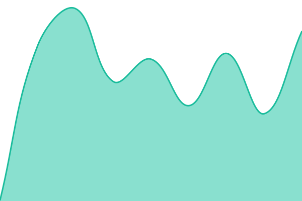
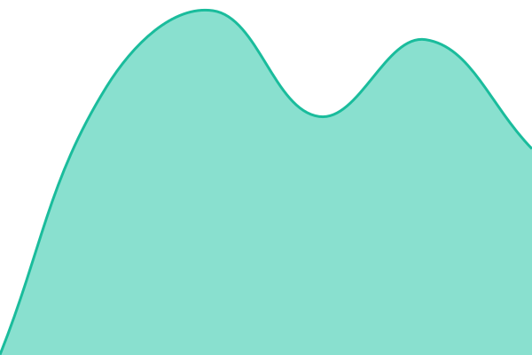
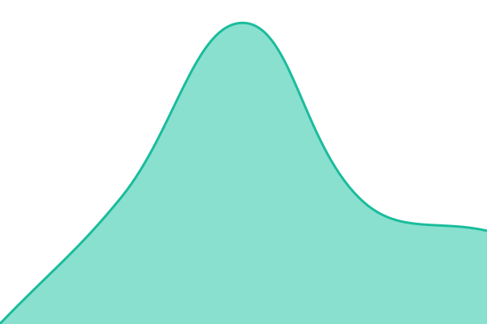
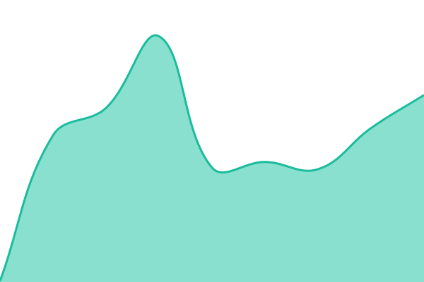

# [📈 Live Status](https://status.latentspace-labs.ch): <!--live status--> **🟩 All systems operational**

This repository contains the open-source uptime monitor and status page for [Joel Barmettler](https://joelbarmettler.xyz), powered by [Upptime](https://github.com/upptime/upptime).

With [Upptime](https://upptime.js.org), you can get your own unlimited and free uptime monitor and status page, powered entirely by a GitHub repository. We use [Issues](https://github.com/joelbarmettlerUZH/latentspace-labs-status/issues) as incident reports, [Actions](https://github.com/joelbarmettlerUZH/latentspace-labs-status/actions) as uptime monitors, and [Pages](https://status.latentspace-labs.ch) for the status page.

<!--start: status pages-->
<!-- This summary is generated by Upptime (https://github.com/upptime/upptime) -->
<!-- Do not edit this manually, your changes will be overwritten -->
<!-- prettier-ignore -->
| URL | Status | History | Response Time | Uptime |
| --- | ------ | ------- | ------------- | ------ |
|  [Slidev MCP Website](https://slidev-mcp.org) | 🟩 Up | [slidev-mcp-web.yml](https://github.com/joelbarmettlerUZH/latentspace-labs-status/commits/HEAD/history/slidev-mcp-web.yml) | 

 214ms
     
 | 

<a href="https://status.latentspace-labs.ch/history/slidev-mcp-web">100.00%</a>
    

|  [Slidev MCP Server](https://mcp.slidev-mcp.org/health) | 🟩 Up | [slidev-mcp-server.yml](https://github.com/joelbarmettlerUZH/latentspace-labs-status/commits/HEAD/history/slidev-mcp-server.yml) | 

 467ms
     
 | 

<a href="https://status.latentspace-labs.ch/history/slidev-mcp-server">100.00%</a>
    

|  [Vue MCP Website](https://vue-mcp.org) | 🟩 Up | [vue-mcp-web.yml](https://github.com/joelbarmettlerUZH/latentspace-labs-status/commits/HEAD/history/vue-mcp-web.yml) | 

 265ms
     
 | 

<a href="https://status.latentspace-labs.ch/history/vue-mcp-web">100.00%</a>
    

|  [Vue MCP Server](https://mcp.vue-mcp.org/health) | 🟩 Up | [vue-mcp-server.yml](https://github.com/joelbarmettlerUZH/latentspace-labs-status/commits/HEAD/history/vue-mcp-server.yml) | 

 508ms
     
 | 

<a href="https://status.latentspace-labs.ch/history/vue-mcp-server">100.00%</a>
    

|  [Souverana Website](https://souverana.ch) | 🟩 Up | [souverana-web.yml](https://github.com/joelbarmettlerUZH/latentspace-labs-status/commits/HEAD/history/souverana-web.yml) | 

 986ms
     
 | 

<a href="https://status.latentspace-labs.ch/history/souverana-web">100.00%</a>
    

|  [Souverana API](https://souverana.ch/api/health) | 🟩 Up | [souverana-api.yml](https://github.com/joelbarmettlerUZH/latentspace-labs-status/commits/HEAD/history/souverana-api.yml) | 

 493ms
     
 | 

<a href="https://status.latentspace-labs.ch/history/souverana-api">100.00%</a>
    

|  [Souverana Analytics](https://stats.souverana.ch/api/heartbeat) | 🟩 Up | [souverana-analytics.yml](https://github.com/joelbarmettlerUZH/latentspace-labs-status/commits/HEAD/history/souverana-analytics.yml) | 

 791ms
     
 | 

<a href="https://status.latentspace-labs.ch/history/souverana-analytics">100.00%</a>
    

|  [Latentspace Labs Website](https://latentspace-labs.ch) | 🟩 Up | [latentspace-labs-web.yml](https://github.com/joelbarmettlerUZH/latentspace-labs-status/commits/HEAD/history/latentspace-labs-web.yml) | 

 375ms
     
 | 

<a href="https://status.latentspace-labs.ch/history/latentspace-labs-web">100.00%</a>
    

|  [Joel Barmettler Website](https://joelbarmettler.xyz) | 🟩 Up | [joelbarmettler-web.yml](https://github.com/joelbarmettlerUZH/latentspace-labs-status/commits/HEAD/history/joelbarmettler-web.yml) | 

 211ms
     
 | 

<a href="https://status.latentspace-labs.ch/history/joelbarmettler-web">100.00%</a>
    

|  [Unbubble Website](https://unbubble.ch) | 🟩 Up | [unbubble-web.yml](https://github.com/joelbarmettlerUZH/latentspace-labs-status/commits/HEAD/history/unbubble-web.yml) | 

 687ms
     
 | 

<a href="https://status.latentspace-labs.ch/history/unbubble-web">100.00%</a>
    

|  [Unbubble API](https://unbubble.ch/api/ready) | 🟩 Up | [unbubble-api.yml](https://github.com/joelbarmettlerUZH/latentspace-labs-status/commits/HEAD/history/unbubble-api.yml) | 

 396ms
     
 | 

<a href="https://status.latentspace-labs.ch/history/unbubble-api">100.00%</a>
    

|  [Unbubble Analytics](https://analytics.unbubble.ch/api/heartbeat) | 🟩 Up | [unbubble-analytics.yml](https://github.com/joelbarmettlerUZH/latentspace-labs-status/commits/HEAD/history/unbubble-analytics.yml) | 

 674ms
     
 | 

<a href="https://status.latentspace-labs.ch/history/unbubble-analytics">100.00%</a>
    

<!--end: status pages-->

[**Visit our status website →**](https://status.latentspace-labs.ch)

## 📄 License

- Powered by: [Upptime](https://github.com/upptime/upptime)
- Code: [MIT](./LICENSE) © [Anand Chowdhary](https://anandchowdhary.com)
- Data in the `./history` directory: [Open Database License](https://opendatacommons.org/licenses/odbl/1-0/)
